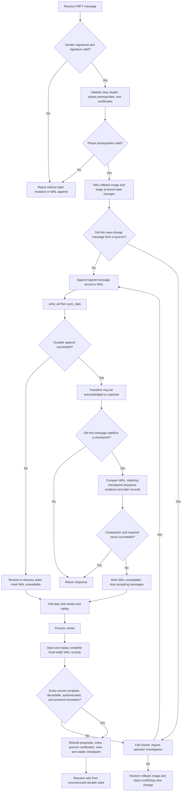

# PBFT durability and crash-recovery flow

This diagram describes the ordering enforced by the Rust message handler and write-ahead log (WAL). It is an implementation guide, not a proof of the full PBFT protocol.

## Durability invariants

1. **No acknowledgment before durability.** A handled message is appended and `sync_data()` completes before the handler returns success.
2. **Failed append means rollback and fail-stop.** A failed append can leave a partial record, so the current node restores its in-memory rollback image and stops processing messages until restart/replay.
3. **Checkpoint evidence must survive compaction.** The WAL retains records at the stable checkpoint sequence so replay can reconstruct the checkpoint quorum; older records can be removed only after the replacement WAL has been written and synced.
4. **Conflicting highest-sequence view-change claims are rejected.** If votes at the maximum prepared sequence report different digests, the new view is not selected based on nondeterministic map iteration.
5. **Recovery fails closed.** A truncated record, invalid compressed point, unknown phase, unregistered signer, invalid signature, or inconsistent protocol prerequisite must not be silently accepted.
6. **A passing workflow is not a proof of crash consistency.** Filesystem-specific crash injection, independent protocol review, and real workload benchmarking remain required.

## Scope and open protocol question

The current view-change message abstraction carries a target view, sequence, and digest, while a full PBFT view-change proof must also preserve enough information to identify and compare prepared certificates from earlier views. This change rejects conflicting digests at the highest reported sequence, eliminating a nondeterministic selection path. It does not yet settle the full PBFT rule for selecting the highest *prepared view* when multiple valid certificates exist for the same sequence. That question still needs protocol-level specification and adversarial tests. See issue #6 before treating this implementation as production-ready.
